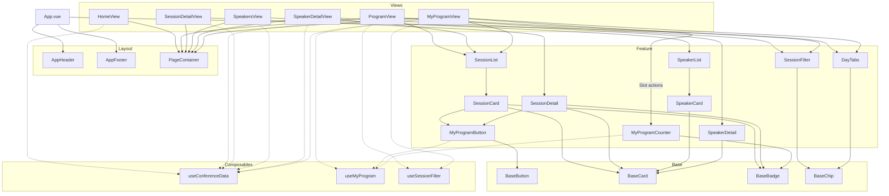

# ADR 02: Komponenten- und Ordnerstruktur

Setup: Vue 3 + Vite + vue-router + TypeScript

## 1. Kontext

PixelFlow zeigt die Konferenz "FrontendNow" mit mehreren Seitentypen: Programmübersicht, Session-Detail, Speaker-Übersicht, Speaker-Detail und "Mein Programm". Die Daten sind über IDs verknüpft. In den Schritten 2 bis 4 kommen Features dazu. Das heißt die Struktur muss wachsen können.

Zwei Personen arbeiten parallel daran, wir brauchen insgesamt klare Zuständigkeiten und am besten wenig Merge Konflikte. Die Design Tokens sind in primitive, semantische und komponentenspezifische Tokens unterteilt. Diese Struktur ermöglicht eine spätere Erweiterung von einem Dark Mode. Komponenten verwenden semantische oder darauf aufbauende Komponenten Tokens anstatt hard-coded Farbwerte.

Anforderungen: Sessions durchsuchen und filtern (Suchtext, Tag, Level, Track, Format, Speaker), Speaker-Profile ansehen und "Mein Programm" zusammenstellen. 
Die Programmübersicht und "Mein Programm" brauchen dieselbe Filterung auf unterschiedlichen Session Listen.

## 2. Optionen

**Option A: nach Typ sortieren.** Alle Komponenten in einem gemeinsamen components/ Ordner, ohne fachliche Unterordner. Dies ist einfach und übersichtlich. Wenn es aber mehr Komponenten werden wird es schwieriger zusammengehörende Funktionen zu finden.

**Option B: nach Thema sortieren.** Vollständige Feature-Struktur, z.B. features/program/, jeweils mit eigenen Komponenten und Composables. Dadurch liegen zusammengehörende Dateien beieinander. Das ist aber für uns Zwei dann ein größer organisatorischer Aufwand. Gemeinsam verwendete Komponenten benötigen weiterhin einen übergreifenden Bereich.

**Option C: Mischform.** Die oberste Ebene wird nach technischen Aufgaben organisiert. Innerhalb von components/ unterscheiden wir zwischen Base/UI, Feature und Layout. Fachliche Komponenten werden bei Bedarf innerhalb von components/feature/ nach Themen gruppiert. Diese Varianten würde eine einfach Grundstruktur mit einer besseren Übersicht bei größer werdender Anwendung kombinieren.

## 3. Entscheidung

Wir wählen Option C. Sie nutzt die Schichten aus der Aufgabe und gruppiert nur dort nach Thema, wo es sich auch wirklich lohnt. Der Einstieg bleibt einfach und ein späterer Umbau auf Option B ist noch möglich.

```
src/
├── App.vue               # Rahmen mit Header, Footer, RouterView
├── main.ts
├── assets/styles/
├── components/
│   ├── base/             # BaseButton, BaseChip, BaseBadge, BaseCard
│   ├── feature/          # program/, speakers/, schedule/
│   └── layout/           # AppHeader, AppFooter, PageContainer
├── composables/          # useConferenceData, useMyProgram, useSessionFilter
├── data/                 # conference-data.json
├── router/
├── types/
└── views/
```

### Komponentenschichten

| Schicht | Inhalt | Regeln |
|---|---|---|
| Base/UI | Generische Bausteine (Button, Chip, Karte, Badge) | Diese kennen keine Sessions. Daten kommen per Props rein und Ereignisse per Events raus. Styling mit semantische und komponentenspezifischen Tokens |
| Feature | Konferenzspezifische Bausteine (SessionCard, SessionFilter, MyProgramCounter) | Diese dürfen Base Komponenten und Composables nutzen. Listen und Karten bekommen ihre Daten per Props |
| Layout | Seitenrahmen (Header, Footer, Container) | Keine Fachlogik, kein Import von Composables oder Feature Komponenten. Inhalte für den Header kommen per Slot |
| Views | Eine Datei pro Seite, wird vom Router geladen | Rufen Composables auf und setzen Layout und Feature Komponenten zusammen |

Abhängigkeitsrichtung: App.vue / views → layout / feature → base. Base importiert nie aus Feature, Layout nie aus Feature.

### Header und Programmzähler

Der Zähler für "Mein Programm" ist Fachlogik und gehört aus diesem Grund nicht in den AppHeader. Der AppHeader bietet einen Slot actions und App.vue setzt dort MyProgramCounter ein. Dadurch bleibt das Layout frei von der Logik und der Zähler aktualisiert sich trotzdem sofort.

### Verbindung zu den Design-Tokens

| Komponenten-Token | Komponente |
|---|---|
| button-primary | BaseButton |
| session-card | SessionCard, basiert auf BaseCard |
| filter-selected | BaseChip im Zustand "ausgewählt" und wird vom SessionFilter genutzt |

Komponenten verwenden nur CSS-Variablen aus tokens.css und keine Rohwerte.

### Headless-Prüfung

**Session-Filterung: headless.** Die Filterlogik liegt in useSessionFilter(sessions) und die Darstellung in SessionFilter.vue.

- Das Composable bekommt die zu filternde Liste als Parameter und liefert dann filters, results und reset().
- Die View ruft das Composable auf. Sie gibt filters per v-model und die verfügbaren Optionen an SessionFilter und results per Prop an SessionList. Der Filter und die Liste teilen sich so einen Zustand und müssen dadurch nichts voneinander wissen
- Die Programmübersicht ruft useSessionFilter(sessions) mit allen Sessions auf. "Mein Programm" wird mit mySessions aufgerufen. Die Logik wird insgesamt einmal geschrieben und zweimal genutzt
- Es ist ohne Oberfläche testbar und die Darstellung kann geändert werden, ohne die Logik anzufassen

**"Zum Programm hinzufügen" benötigt keine zusätzliche Schicht.**  
Die Logik steckt bereits in useMyProgram() und MyProgramButton ruft nur toggle(id) auf und zeigt has(id) an.

## 4. Konsequenzen

Positive Konsequenzen wären:
- Klare Zuständigkeiten: Base und Tokens auf der einen, Feature und State auf der anderen Seite
- Der Dark Mode ist vorbereitet, weil Komponenten nur semantische und komponentenspezifische Tokens kennen
- Die Filterlogik wird einmal geschrieben und mehrfach genutzt
- Das Layout bleibt frei von der Fachlogik, auch beim Programmzähler im Header

Negative Konsequenzen und Risiken wären:
- components/feature/ kann mit der Zeit unübersichtlich werden. Dann würden wir einen Umstieg auf Option B in Erwägung ziehen
- Views müssen Composables aufrufen und Daten weiterreichen. Das ist etwas mehr Verdrahtung als bei den Komponenten, die sich die Daten selbst holen. Dafür bleiben die Komponenten wiederverwendbar
- tokens.json verwaltet die Design Tokens. Für die Verwendung in VUe Komponenten müssen die Token Referenzen in CSS Custom Properties umgewandelt werden

## 5. Komponentenübersicht



Durchgezogene Pfeile: „verwendet".
Gestrichelte Pfeile: "holt Daten oder Logik von"
SessionList, SessionCard, SpeakerList und SpeakerCard holen sich keine Daten selbst. Sie bekommen sie von der View übergeben.