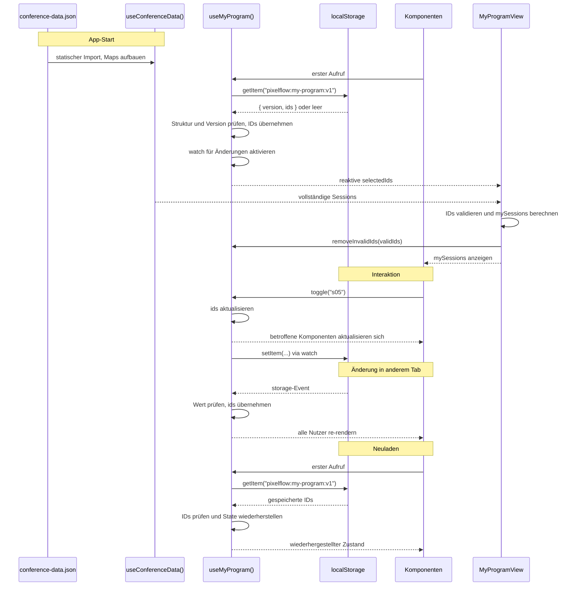

# State-Management-Konzept: "Mein Programm" und conference-data.json

## 1. Der Datensatz

conference-data.json enthält Tracks, Räume, 18 Speaker und 20 Sessions. Diese verweisen über IDs aufeinander, z.B. trackId: "keynote". Die Daten ändern sich zur Laufzeit nicht. Aus diesem Grund importieren wir die Datei direkt ins Projekt, anstatt sie nachzuladen. Dadurch gibt es keine Ladezustände und keine Netzfehler. Durch den statischen Import werden die Konferenzdaten in die Anwendung eingebunden. Eine spätere Offline Nutzung ist möglich, wenn die erforderlichen Anwendungsdateien durch den Service Worker zwischengespeichert werden. Der Nachteil ist, dass wir bei Änderungen an den Daten neu bauen müssen.

Die Speaker haben zusätzlich sessionIds. Das ist dieselbe Information wie bei speakerIds bei den Sessions, nur in die andere Richtung. Wir nehmen die Session Seite als Maßeinheit, damit es insgesamt nur eine Quelle der Wahrheit gibt.

## 2. Konferenzdaten: useConferenceData()

Das Composable wird einmal beim Start aufgebaut. Es legt Nachschlagetabellen nach ID an und stellt sessions, speakers, tracks, rooms und getSession(id) bereit. Sessions gibt es auch mit aufgelösten Verweisen, also mit dem Tracknamen statt der trackId. Die Daten sind schreibgeschützt, damit auch keine Komponente sie aus Versehen ändern kann.

## 3. Persönlicher State: useMyProgram()

Wir speichern nur die Session IDs und keine ganzen Objekte:

- Titel, Zeit und Raum kommen immer aus useConferenceData()
- Es muss nur wenig gespeichert werden
- Es können keine veralteten Kopien entstehen, wenn sich die JSON ändert

Die Alternative wäre, ganze Session-Objekte zu speichern. Das wäre beim Anzeigen etwas einfacher, aber es würde Daten doppelt halten und nach einer Änderung der JSON falsche Titel oder Zeiten anzeigen. Bei nur 20 Sessions ist der Aufwand für das Nachschlagen anhand der IDs nicht so wichtig.

Die Schnittstelle von useMyProgram() besteht aus selectedIds, has(id), toggle(id), count und removeInvalidIds(validIds). Die MyProgramView kombiniert die ausgewählten IDs mit den vollständigen Sessions aus useConferenceData() und berechnet daraus mySessions mittels computed. Dabei überprüft die View auch, ob die gespeicherten IDs noch existieren und lässt ungültige Einträge über removeInvalidIds(validIds) entfernen. Dadurch bleiben die beiden Composables voneinander unabhängig.

## 4. Verteilung an die Komponenten

Die ID Liste liegt als ref außerhalb der Composable Funktion. Alle Komponenten teilen sich die selbe Liste und auch nur die, welche useMyProgram() aufrufen. Wenn jemand im MyProgramButton auf "Zum Programm" klickt, aktualisiert sich der MyProgramCounter dann im Header sofort.

## 5. Persistenz und Rehydration

- **Schlüssel:** pixelflow:my-program:v1, Wert: { "version": 1, "ids": ["s02", "s05"] }. Mit dem Versionsfeld können wir das Format dann später ändern
- **Laden und Initialisierung:** Beim ersten Aufruf von useMyPgroamm() werden die Daten aus localStorage geladen, geprüft und in den reaktiven State übernommen. Danach wird der watch aktiviert und ungültige Session IDs werden durch die MyProgramView entfernt
- **Speichern:** Ein watch schreibt bei jeder Änderung
- **Fehlerfall:** Alle Zugriffe stehen in try/catch. Bei kaputten Daten oder gesperrtem Speicher startet ein leeres Programm. Nicht mehr vorhandene Session IDs werden beim ABgleich in der MyProgramView entfernt
- **Mehrere Tabs:** Wir hören auf das storage-Event und übernehmen Änderungen aus dem anderen Tab, sonst würde der Tab, der zuletzt schreibt, das Programm des anderen überschreiben

## 6. Grenzen

localStorage gibt es nur im Browser. Deswegen erfolgt die Initialisierung des persönlichen States clientseitig. Unser gewähltes Setup mit Vue + Vite + Vue Router eignet sich dafür gut. Bei einer späteren Umstellung auf SSR müsste dann der Zugriff auf localStorage ensprechend abgesichert werden.

## 7. Datenfluss

