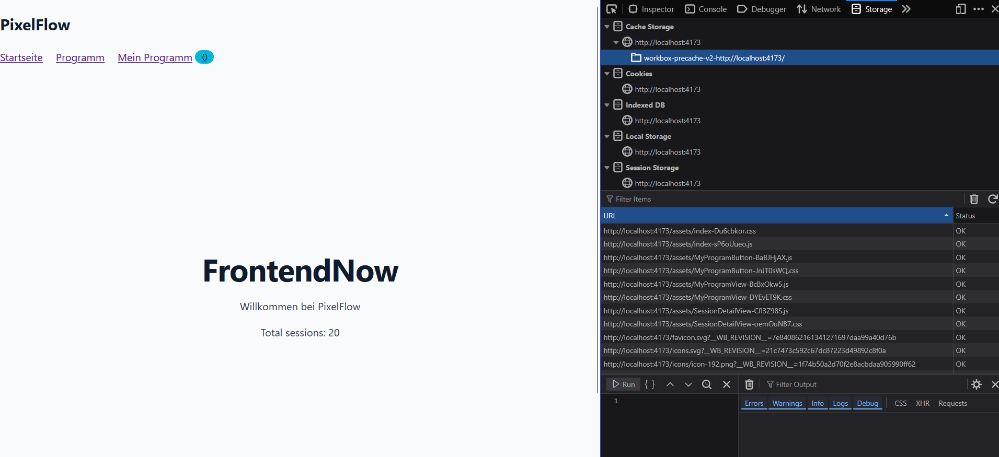
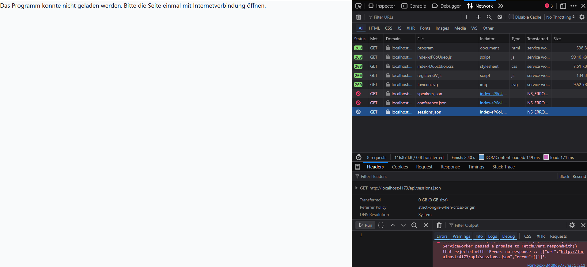

# Entscheidungsprotokoll 02: Offline- und Caching-Strategie

Status: Accepted  
Technologie: vite-plugin-pwa 2.0 (generateSW / Workbox), Vue 3, Vite  
Bezug: Rendering-Entscheidungen siehe [ADR 01 Rendering-Strategie](../schritt2/01-rendering-strategie-adr.md), Konzept siehe [Offline-Strategie-Konzept](02-offline-strategie-konzept.md), Umsetzung siehe `vite.config.ts` (Regeln A–D)

## Kontext
PixelFlow wird während einer Konferenz genutzt, also im Vortragssaal mit überlastetem WLAN oder im Flugmodus zwischen zwei Sessions. Durch die Entscheidung für CSR (ADR 01) braucht die App beim Start JavaScript und die Konferenzdaten (`/api/conference.json`, `/api/sessions.json`, `/api/speakers.json`), die `loadConferenceData()` in `main.ts` vor dem Mounten lädt. Fehlt eines davon, startet die App nicht. Ziel ist, dass die Plattform nach einem Onlinebesuch ohne Netz benutzbar bleibt.

## Optionen
| Option | Verhalten | Passt für |
|---|---|---|
| Precaching | Dateien werden beim Installieren des SW gespeichert und mit jeder neuen SW-Version ersetzt | Build-Dateien, die sich nur mit einem Deployment ändern |
| Cache First | Cache zuerst, Netzwerk nur, wenn nichts gecacht ist | Daten, die sich nach der Veröffentlichung kaum ändern |
| Stale While Revalidate | Sofort aus dem Cache, im Hintergrund wird aktualisiert | Daten mit gelegentlichen Änderungen (z. B. späte Raumänderungen) |
| Network First | Netzwerk zuerst, Cache nur als Fallback | Daten, die immer aktuell sein müssen; bei schlechtem WLAN lange Wartezeiten |
| Keine SW-Regel (localStorage) | Daten liegen bereits im Browser | Clientseitig erzeugte Benutzerdaten |

## Entscheidung
| Datentyp | Strategie | Regel in `vite.config.ts` |
|---|---|---|
| App-Shell (HTML, JS, CSS, Icons, Manifest) | Precaching + `navigateFallback: /index.html` | Regel A |
| Sessions | Cache First (`pixelflow-sessions`) | Regel B |
| Speaker | Cache First (`pixelflow-speakers`) | Regel C |
| Konferenz-Metadaten (Tracks, Räume) | Cache First (`pixelflow-conference`) | Regel D |
| „Mein Programm" | localStorage, keine SW-Regel, braucht nur die App-Shell | – |

Cache First statt Stale While Revalidate, weil das Programm nach der Veröffentlichung weitgehend statisch ist und im Saal jede Netzwerkanfrage bei schlechtem WLAN hängen kann. Stale While Revalidate wäre nötig, sobald während der Konferenz Raum- oder Zeitänderungen veröffentlicht werden.

## Konsequenzen
- Positiv: Nach einem erfolgreichen Onlinebesuch startet die App ohne Netz, das Programm wird ohne Wartezeit aus dem Cache geladen.
- Negativ: Kurzfristige Änderungen an Sessions erreichen Besucher nicht, solange ihr Cache existiert (kein Ablaufdatum gesetzt).
- Negativ: Ohne vorherigen Onlinebesuch gibt es keinen Offline-Betrieb (Szenario iii).
- Negativ: „Mein Programm" ist an Browser und Gerät gebunden.
- Negativ (durch Szenario i aufgedeckt): Die Runtime-Caches werden erst ab dem zweiten Laden befüllt, weil der Service Worker beim ersten Besuch noch nicht aktiv ist, wenn die Daten geladen werden. Wer die App vor der Konferenz nur einmal öffnet, sieht offline nur eine Fehlermeldung.
- TODO nach den Tests ergänzen: welche weiteren Konsequenzen haben sich gezeigt?

## Testszenarien

Testumgebung: Produktions-Build (`npm run build` + `npm run preview`, http://localhost:4173), da der Service Worker im Dev-Server nicht aktiv ist. Beide Personen haben in unterschiedlichen Browsern getestet. Die Art der Offline-Simulation steht in der Tabelle.

| | Person 1 | Person 2 |
|---|---|---|
| Name | TODO | David |
| Betriebssystem | TODO | Windows 11 |
| Browser + Version | TODO | Firefox 161.0 (64-bit) |
| Offline-Simulation | TODO | DevTools-Throttling „Offline" und/oder Preview-Server gestoppt |
| Commit | TODO | `9dc2344` |

### Szenario i: Session-Übersicht offline nach vorherigem Onlinebesuch
#### Durchlauf 1 – Person 2 (Firefox 161, Commit `9dc2344`)
**Ausgangslage:** Über das Schloss-Symbol „Cookies und Website-Daten löschen…" wurden alle Daten von `localhost:4173` entfernt. Danach wurde die Seite genau einmal online geladen, ohne weiteren Reload. In DevTools → Web-Speicher → Cache Storage war anschließend nur `workbox-precache-v2-http://localhost:4173/` vorhanden. Die Runtime-Caches `pixelflow-sessions`, `pixelflow-speakers` und `pixelflow-conference` fehlten.

**Aktion:** Preview-Server mit Strg+C gestoppt, danach die Seite neu geladen (Strg+R).

**Beobachtetes Verhalten:** Die App-Shell kam aus dem Precache, die Seite war also keine Browser-Fehlerseite. Statt des Programms erschien aber nur die Meldung „Das Programm konnte nicht geladen werden. Bitte die Seite einmal mit Internetverbindung öffnen." aus `main.ts`.

**Ergebnis:** Nicht bestanden. Ursache: Beim ersten Besuch lädt `loadConferenceData()` die JSON-Dateien, bevor der Service Worker installiert ist. Diese Requests laufen am Service Worker vorbei, deshalb füllen die Cache-First-Regeln B–D ihre Caches nicht. Die JSON-Dateien sind bewusst nicht im Precache (Regel A). Ein einziger Onlinebesuch reicht also entgegen dem Konzept nicht aus.

Nachweis:  

#### Durchlauf 2 – TODO
**Ausgangslage:** TODO

**Aktion:** TODO

**Beobachtetes Verhalten:** TODO

**Ergebnis:** TODO

### Szenario ii: „Mein Programm" offline nach dem Hinzufügen von Sessions
**Ausgangslage:** Online wurden drei Sessions über den Button zu „Mein Programm" hinzugefügt. In Application → Local Storage ist der Schlüssel `pixelflow:my-program:v1` mit den IDs sichtbar.

**Aktion:** Offline aktivieren, `/my-program` direkt in der Adresszeile aufrufen. Anschließend offline eine Session entfernen, neu laden und prüfen, ob die Änderung erhalten bleibt.

**Beobachtetes Verhalten:** TODO (Werden die gemerkten Sessions mit Titel, Zeit und Raum angezeigt? Wird die Navigation über `navigateFallback` mit `index.html` beantwortet? Bleibt die Änderung nach dem Reload erhalten?)

**Ergebnis:** TODO

Nachweis:  

### Szenario iii: Erstbesuch im Offline-Zustand (bewusster Grenzfall)
**Ausgangslage:** Neues Inkognito-Fenster bzw. Site-Daten gelöscht, kein Service Worker registriert, Cache Storage leer.

**Aktion:** DevTools öffnen, „Offline" aktivieren, dann `http://localhost:4173/` aufrufen.

**Beobachtetes Verhalten:** TODO (Browser-Fehlerseite? Oder die Meldung aus `main.ts` „Das Programm konnte nicht geladen werden …"?)

**Ergebnis und Bewertung:** TODO. Warum ist dieses Verhalten akzeptabel? (Ein Service Worker kann erst nach dem ersten Laden installiert werden, und Besucher öffnen die App typischerweise vor der Konferenz, z. B. über den Link in der Anmeldebestätigung. Was wäre eine mögliche Verbesserung?)

Nachweis: 

## Zusammenführung der Testergebnisse
TODO: Unterschiede zwischen beiden Rechnern, gefundene Lücken und daraus abgeleitete Änderungen (mit Commit-Hash).
