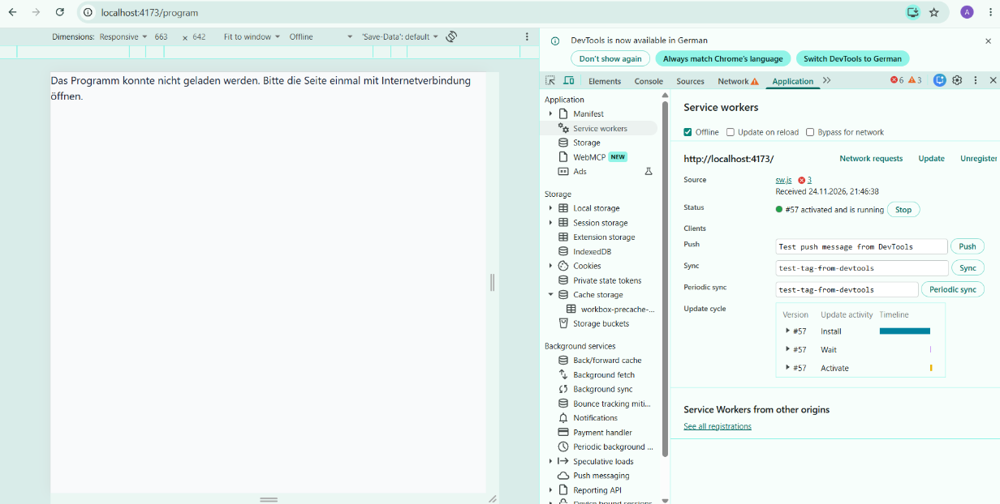
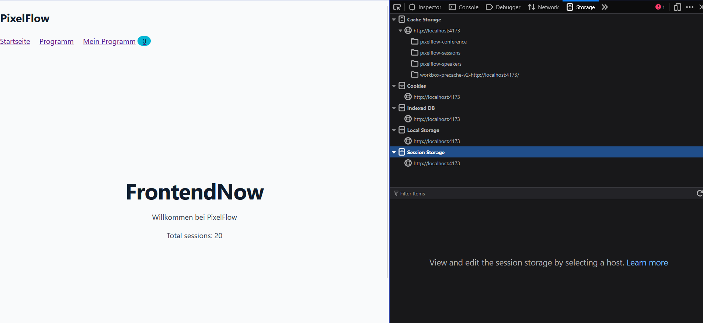
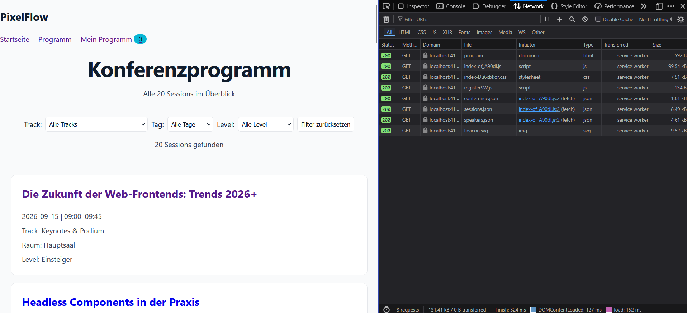
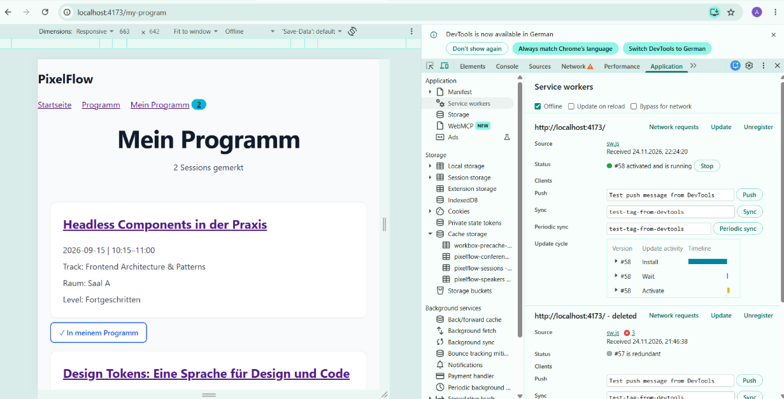
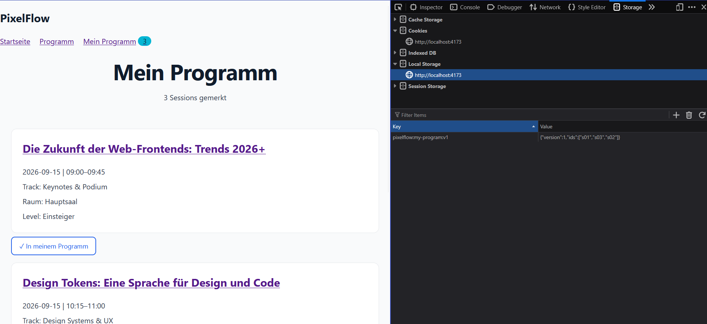
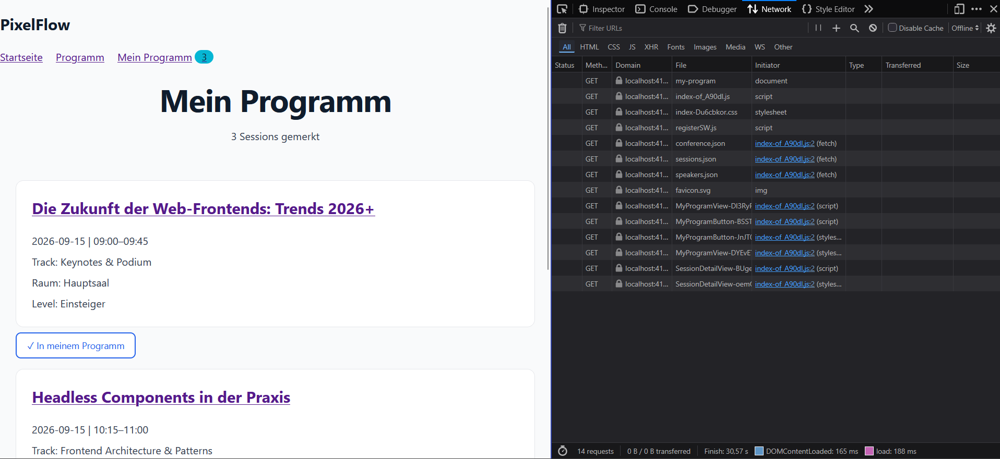
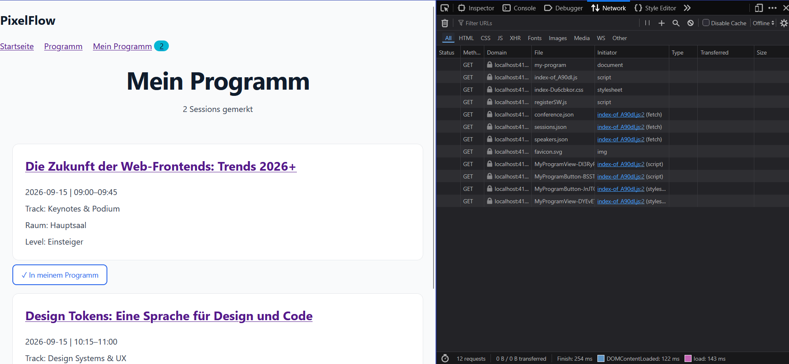
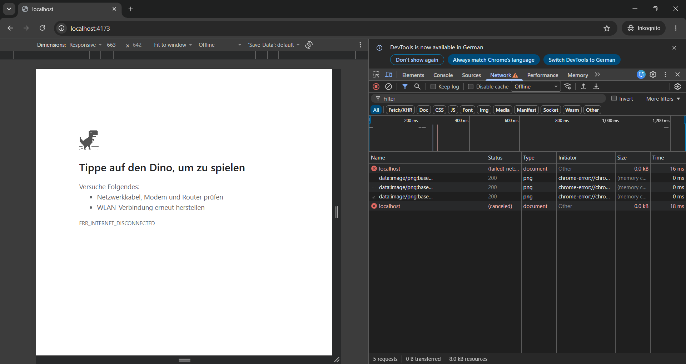
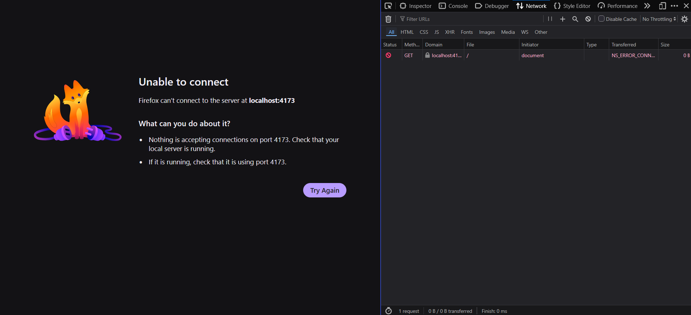

# Entscheidungsprotokoll 02: Offline- und Caching-Strategie

Status: Accepted  
Technologie: vite-plugin-pwa 2.0 (generateSW / Workbox), Vue 3, Vite  
Bezug: Rendering-Entscheidungen siehe [ADR 01 Rendering-Strategie](../schritt2/01-rendering-strategie-adr.md), Konzept siehe [Offline-Strategie-Konzept](02-offline-strategie-konzept.md), Umsetzung siehe `vite.config.ts` (Regeln A–D)

## Kontext
PixelFlow wird während einer Konferenz genutzt, also im Vortragssaal mit überlastetem WLAN oder im Flugmodus zwischen zwei Sessions. Durch die Entscheidung für CSR (ADR 01) braucht die App beim Start JavaScript und die Konferenzdaten (`/api/conference.json`, `/api/sessions.json`, `/api/speakers.json`), die `loadConferenceData()` in `main.ts` vor dem Mounten lädt. Fehlt eines davon, startet die App nicht. Ziel ist, dass die Plattform nach einem Onlinebesuch ohne Netz benutzbar bleibt.

## Optionen
| Option | Verhalten | Passt für |
|---|---|---|
| Precaching | Dateien werden beim Installieren des SW gespeichert und mit jeder neuen SW-Version ersetzt | Build-Dateien, die sich nur mit einem Deployment ändern |
| Cache First | Cache zuerst, Netzwerk nur, wenn nichts gecacht ist | Daten, die sich nach der Veröffentlichung kaum ändern |
| Stale While Revalidate | Sofort aus dem Cache, im Hintergrund wird aktualisiert | Daten mit gelegentlichen Änderungen (z. B. späte Raumänderungen) |
| Network First | Netzwerk zuerst, Cache nur als Fallback | Daten, die immer aktuell sein müssen; bei schlechtem WLAN lange Wartezeiten |
| Keine SW-Regel (localStorage) | Daten liegen bereits im Browser | Clientseitig erzeugte Benutzerdaten |

## Entscheidung
| Datentyp | Strategie | Regel in `vite.config.ts` |
|---|---|---|
| App-Shell (HTML, JS, CSS, Icons, Manifest) | Precaching + `navigateFallback: /index.html` | Regel A |
| Sessions | Cache First (`pixelflow-sessions`) | Regel B |
| Speaker | Cache First (`pixelflow-speakers`) | Regel C |
| Konferenz-Metadaten (Tracks, Räume) | Cache First (`pixelflow-conference`) | Regel D |
| „Mein Programm" | localStorage, keine SW-Regel, braucht nur die App-Shell | – |

Cache First statt Stale While Revalidate, weil das Programm nach der Veröffentlichung weitgehend statisch ist und im Saal jede Netzwerkanfrage bei schlechtem WLAN hängen kann. Stale While Revalidate wäre nötig, sobald während der Konferenz Raum- oder Zeitänderungen veröffentlicht werden.

## Konsequenzen
- Positiv: Nach einem erfolgreichen Onlinebesuch startet die App ohne Netz, das Programm wird ohne Wartezeit aus dem Cache geladen.
- Negativ: Kurzfristige Änderungen an Sessions erreichen Besucher nicht, solange ihr Cache existiert (kein Ablaufdatum gesetzt).
- Negativ: Ohne vorherigen Onlinebesuch gibt es keinen Offline-Betrieb (Szenario iii).
- Negativ: „Mein Programm" ist an Browser und Gerät gebunden.
- Negativ (durch Szenario i aufgedeckt): Die Runtime-Caches werden erst ab dem zweiten Laden befüllt, weil der Service Worker beim ersten Besuch noch nicht aktiv ist, wenn die Daten geladen werden. Wer die App vor der Konferenz nur einmal öffnet, sieht offline nur eine Fehlermeldung. Behoben in Commit `b82bcd5`: `main.ts` fordert die Daten nach der Aktivierung des Service Workers erneut an (siehe Szenario i, Durchlauf 4).
- TODO nach den Tests ergänzen: welche weiteren Konsequenzen haben sich gezeigt?

## Testszenarien

Testumgebung: Produktions-Build (`npm run build` + `npm run preview`, http://localhost:4173), da der Service Worker im Dev-Server nicht aktiv ist. Beide Personen haben in unterschiedlichen Browsern getestet. Die Art der Offline-Simulation steht in der Tabelle.

| | Person 1 | Person 2 |
|---|---|---|
| Name | Armin | David |
| Betriebssystem | Windows 11 | Windows 11 |
| Browser + Version | Google Chrome | Firefox 161.0 (64-bit) |
| Offline-Simulation | Chrome DevTools -> Application -> Service Workers -> Offline; bei Szenario iii Network -> Offline | DevTools-Throttling „Offline" und/oder Preview-Server gestoppt |
| Commit | `8e52005` | `9dc2344` (Durchlauf 1), `b82bcd5` (Szenario i Durchlauf 4, Szenario ii Durchlauf 2, Szenario iii Durchlauf 2) |

### Szenario i: Session-Übersicht offline nach vorherigem Onlinebesuch
#### Durchlauf 1 – Person 2 (Firefox 161, Commit `9dc2344`)
**Ausgangslage:** Über das Schloss-Symbol „Cookies und Website-Daten löschen…" wurden alle Daten von `localhost:4173` entfernt. Danach wurde die Seite genau einmal online geladen, ohne weiteren Reload. In DevTools → Web-Speicher → Cache Storage war anschließend nur `workbox-precache-v2-http://localhost:4173/` vorhanden. Die Runtime-Caches `pixelflow-sessions`, `pixelflow-speakers` und `pixelflow-conference` fehlten.

**Aktion:** Preview-Server mit Strg+C gestoppt, danach die Seite neu geladen (Strg+R).

**Beobachtetes Verhalten:** Die App-Shell kam aus dem Precache, die Seite war also keine Browser-Fehlerseite. Statt des Programms erschien aber nur die Meldung „Das Programm konnte nicht geladen werden. Bitte die Seite einmal mit Internetverbindung öffnen." aus `main.ts`.

**Ergebnis:** Nicht bestanden. Ursache: Beim ersten Besuch lädt `loadConferenceData()` die JSON-Dateien, bevor der Service Worker installiert ist. Diese Requests laufen am Service Worker vorbei, deshalb füllen die Cache-First-Regeln B–D ihre Caches nicht. Die JSON-Dateien sind bewusst nicht im Precache (Regel A). Ein einziger Onlinebesuch reicht also entgegen dem Konzept nicht aus.

Nachweis:  

#### Durchlauf 2 – Person 1 (Google Chrome, Windows)
**Ausgangslage:** Vor dem Test wurden sämtliche Website-Daten von localhost:4173 gelöscht, einschließlich des Service Workers und aller Cache-Einträge. Anschließend habe ich PixelFlow genau einmal online geöffnet. Unter Application -> Cache Storage war danach ausschließlich der Workbox-Precache vorhanden. Die Runtime-Caches für Sessions, Speaker und Konferenz-Metadaten fehlten.

**Aktion:** In Chrome DevTools unter Application -> Service Workers den Offline-Modus aktiviert und die Programmübersicht unter /program erneut geladen.

**Beobachtetes Verhalten:** Die App-Shell wurde weiterhin aus dem Precache geladen. Allerdings konnte die Session-Übersicht nicht angezeigt werden und stattdessen erschien die Fehlermeldung „Das Programm konnte nicht geladen werden. Bitte die Seite einmal mit Internetverbindung öffnen.“

**Ergebnis:** Nicht bestanden. Damit wurde die bereits in Firefox festgestellte Einschränkung auch in Chrome wiederholt. Ein einmaliger Online-Besuch reicht derzeit nicht zuverlässig aus, um die benötigten Konferenzdaten offline verfügbar zu machen.

Nachweis: 

#### Durchlauf 3 – Person 1 (Google Chrome, Windows)
**Ausgangslage:** Die Anwendung habe ich mehrfach mit aktiver Netzwerkverbindung geöffnet. Anschließend habe ich unter Application -> Cache Storage überprüft, ob der Workbox-Precache und die drei Runtime-Caches pixelflow-sessions, pixelflow-speakers und pixelflow-conference vorhanden waren.

**Aktion:** Der Offline-Modus wurde von mir in Chrome DevTools aktiviert und die Programmübersicht unter /program erneut geöffnet.

**Beobachtetes Verhalten:** Die Anwendung konnte vollständig geladen werden. Alle 20 Sessions wurden angezeigt und die Filter nach Track, Konferenztag und Level funktionierten weiterhin ohne Netzwerkverbindung.

**Ergebnis:** Bestanden. Sobald die Runtime-Caches befüllt sind, funktioniert die Offline-Nutzung wie vorgesehen. Der Vergleich zeigt, dass nicht allein das Vorhandensein eines Service Workers entscheidend ist, sondern auch ob die benötigten Konferenzdaten bereits gespeichert wurden.

#### Durchlauf 4 – Person 2 (Firefox 161, Commit `b82bcd5`, nach dem Fix)
**Ausgangslage:** Als Reaktion auf Durchlauf 1 und 2 fordert `main.ts` die drei JSON-Dateien beim ersten Besuch erneut an, sobald der Service Worker die Seite kontrolliert. Diese Requests laufen über die Cache-First-Regeln B–D. Wie in Durchlauf 1 wurden alle Website-Daten gelöscht, der Service Worker abgemeldet und die Seite in einem neuen Tab genau einmal online geladen. Danach zeigte Cache Storage neben `workbox-precache-v2-…` auch `pixelflow-conference`, `pixelflow-sessions` und `pixelflow-speakers`.

**Aktion:** Innerhalb der App zu `/program` navigiert, Preview-Server mit Strg+C gestoppt, Seite neu geladen (Strg+R).

**Beobachtetes Verhalten:** Die Programmübersicht wurde mit allen 20 Sessions angezeigt. Im Netzwerk-Tab zeigten alle 8 Requests (Dokument, JS, CSS, `conference.json`, `sessions.json`, `speakers.json`, Icon) in der Spalte „Übertragen" den Wert „service worker.

**Ergebnis:** Bestanden. Ein einmaliger Onlinebesuch reicht nach dem Fix aus, so wie im Konzept vorgesehen. Die Strategie Cache First blieb unverändert, nur die erstmalige Befüllung der Runtime-Caches wurde korrigiert.

Nachweis:  

### Szenario ii: „Mein Programm" offline nach dem Hinzufügen von Sessions
#### Durchlauf 1 – Person 1 (Google Chrome, Windows)
**Ausgangslage:** Zunächst habe ich die Platform online geöffnet und drei Sessions zum persönlichen Programm hinzugefügt. Die Auswahl wurde über localStorage gespeichert. Die benötigten Konferenzdaten und statischen Dateien waren bereits im Cache vorhanden.

**Aktion:** Danach habe ich in Chrome DevTools den Offline-Modus aktiviert und die Seite „Mein Programm“ unter /my-program erneut geladen. Während des Offline-Modus habe ich eine der drei gespeicherten Sessions entfernt. Danach wurde die Seite nochmals neu geladen.

**Beobachtetes Verhalten:** Das persönliche Programm konnte trotz fehlender Internetverbindung vollständig angezeigt werden. Nach dem Entfernen einer Session waren nur noch zwei Sessions gespeichert. Auch nach dem erneuten Laden blieb diese Änderung erhalten. Die Sessioninformationen einschließlich Titel, Track, Raum und Level wurden weiterhin korrekt angezeigt.

**Ergebnis:** Bestanden. Die Speicherung über localStorage funktioniert auch ohne Internetverbindung. Gemeinsam mit dem App-Shell-Precaching und den Cache-First-Regeln für Konferenzdaten bleibt das persönliche Programm offline nutzbar. Eine Synchronisierung zwischen unterschiedlichen Browsern oder Geräten findet allerdings nicht statt.

Nachweis: 

#### Durchlauf 2 – Person 2 (Firefox 161, Commit `b82bcd5`)
**Ausgangslage:** Die App wurde online geöffnet und drei Sessions über den Button „+ Zu meinem Programm" gemerkt. Im Web-Speicher unter Local Storage → `http://localhost:4173` stand danach der Schlüssel `pixelflow:my-program:v1` mit dem Wert `{"version":1,"ids":["s01","s03","s02"]}`, der Zähler in der Navigation zeigte 3.

**Aktion:** Im Netzwerk-Tab das Throttling auf „Offline" gestellt und `http://localhost:4173/my-program` direkt in die Adresszeile eingegeben. Anschließend offline eine Session entfernt und die Seite neu geladen.

**Beobachtetes Verhalten:** „Mein Programm" wurde mit „3 Sessions gemerkt" und vollständigen Angaben (Titel, Datum, Uhrzeit, Track, Raum, Level) angezeigt. Die direkte Navigation wurde also über `navigateFallback` mit der gecachten `index.html` beantwortet. Nach dem Entfernen und dem Reload waren weiterhin die zwei verbleibenden Sessions sichtbar. Anders als bei gestopptem Server (Szenario i, Durchlauf 4) zeigte Firefox im DevTools-Offline-Modus bei allen 14 Requests leere Spalten „Status" und „Übertragen" statt „service worker". Die Fußzeile meldete „0 B / 0 B transferred", die Inhalte kamen also nicht über das Netzwerk.

**Ergebnis:** Bestanden. Ergebnis deckt sich mit Durchlauf 1 in Chrome. localStorage funktioniert unabhängig vom Netz, Precache (Regel A) und die Cache-First-Regeln B–D liefern App-Shell und Sessiondaten. Die Anzeige im Netzwerk-Tab hängt in Firefox von der Offline-Methode ab und ist daher allein kein eindeutiger Nachweis.

Nachweis:  

### Szenario iii: Erstbesuch im Offline-Zustand (bewusster Grenzfall)
#### Durchlauf 1 – Person 1 (Google Chrome, Windows)
**Ausgangslage:** Für diesen Test habe ich alle bisherigen Inkognito-Fenster geschlossen. Danach habe ich ein neues Inkognito-Fenster in Google Chrome geöffnet. PixelFlow war in diesem Browser-Kontext noch nicht besucht worden. Somit waren weder ein registrierter Service Worker noch gespeicherte PWA-Dateien vorhanden.

**Aktion:** Vor dem ersten Aufruf habe ich in Chrome DevTools unter Network den Offline-Modus aktiviert. Erst danach wurde http://localhost:4173/ in der Adresszeile aufgerufen.

**Beobachtetes Verhalten:** PixelFlow konnte nicht geladen werden. Stattdessen erschien die Chrome-Fehlerseite mit dem Fehlercode ERR_INTERNET_DISCONNECTED. Im Network-Tab war die fehlgeschlagene Anfrage an localhost sichtbar.

**Ergebnis und Bewertung:** Das Verhalten entspricht der dokumentierten Einschränkung des PWA-Prototyps. Ohne vorherigen Online-Besuch kann kein Service Worker installiert werden und es stehen keine gecachten Dateien zur Verfügung. Der Offline-Erstbesuch wird deshalb nicht unterstützt. Eine mögliche Verbesserung wäre, Benutzer bereits vor der Konferenz ausdrücklich auf den notwendigen ersten Online-Aufruf hinzuweisen.

Nachweis: 

#### Durchlauf 2 – Person 2 (Firefox 161, Commit `b82bcd5`)
**Ausgangslage:** Über das Schloss-Symbol wurden alle Cookies und Website-Daten von `localhost:4173` gelöscht und der Service Worker in DevTools → Anwendung abgemeldet. Service Workers, Cache Storage und Local Storage waren danach leer. Für Firefox wurde bewusst kein privates Fenster verwendet, sondern derselbe, vollständig bereinigte Browser-Kontext wie in den anderen Szenarien.

**Aktion:** Preview-Server mit Strg+C gestoppt, danach `http://localhost:4173/` in einem neuen Tab aufgerufen.

**Beobachtetes Verhalten:** Firefox zeigte die eigene Fehlerseite „Unable to connect – Firefox can't connect to the server at localhost:4173". Im Netzwerk-Tab erschien genau ein Request (Dokument `/`) mit einem Fehler `NS_ERROR_CONN…` und 0 B Übertragung. Weitere Requests gab es nicht, auch nicht die Meldung aus `main.ts`, weil ohne Service Worker nicht einmal `index.html` verfügbar war.

**Ergebnis und Bewertung:** Wie erwartet, gleiches Ergebnis wie in Chrome. Das Verhalten ist akzeptabel, weil ein Service Worker technisch erst nach dem ersten erfolgreichen Laden installiert werden kann. Keine Caching-Strategie kann diesen Fall lösen. Realistisch öffnen Besucher die App vor der Konferenz, etwa über den Link in der Anmeldebestätigung oder im Hotel-WLAN. Seit dem Fix aus Szenario i reicht dieser eine Besuch aus. Verbesserung: in der Anmeldebestätigung darauf hinweisen, die App vorab einmal zu öffnen bzw. zu installieren.

Nachweis: 

## Zusammenführung der Testergebnisse
Bei Szenario i konnten wir beide unabhängig voneinander dieselbe Einschränkung feststellen. Sowohl in Google Chrome als auch in Mozilla Firefox wurde nach genau einem Online-Besuch lediglich die App-Shell offline geladen. Die Konferenzdaten standen hingegen nicht zur Verfügung, da die Runtime-Caches noch nicht befüllt waren.  
  
Bei einem weiteren Test in Chrome mit bereits gefüllten Runtime-Caches funktionierte die Session-Übersicht vollständig offline. Alle 20 Sessions waren sichtbar und die Filter konnten weiterhin verwendet werden.  
Das zeigt, dass die Offline-Funktionalität von der vorherigen Befüllung der Runtime-Caches abhängt und der Fehler nicht auf einen einzelnen Browser beschränkt ist.  
Die ursprüngliche Annahme, dass ein einmaliger Online-Besuch für die vollständige Offline-Nutzung ausreicht, konnte somit von uns nicht bestätigt werden.  
  
Als Lösung haben wir die zweite Variante umgesetzt (Commit `b82bcd5`): Nach der Aktivierung des Service Workers fordert `main.ts` die Konferenzdaten gezielt erneut an. Das Precaching der JSON-Dateien haben wir verworfen, weil die Daten dann am Precache statt an den Cache-First-Regeln B–D hängen würden und Konzept und Umsetzung nicht mehr übereinstimmen würden. Der erneute Test in Firefox (Szenario i, Durchlauf 4) war erfolgreich: Nach genau einem Onlinebesuch waren alle drei Runtime-Caches befüllt und die Programmübersicht wurde offline vollständig aus dem Service Worker geladen.
