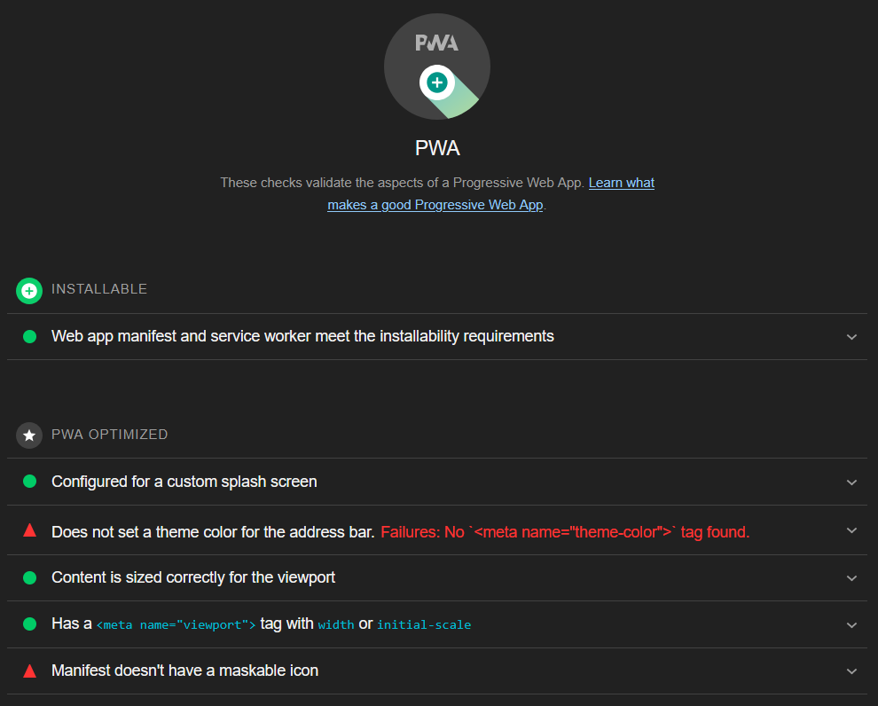
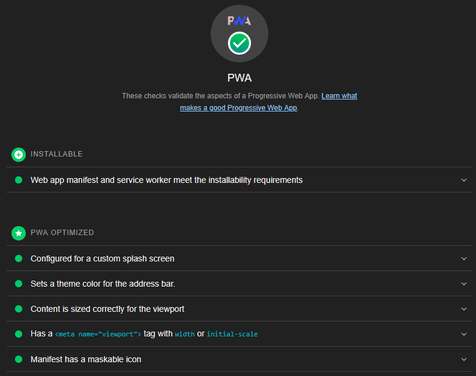
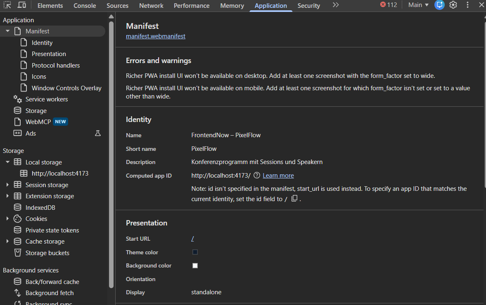
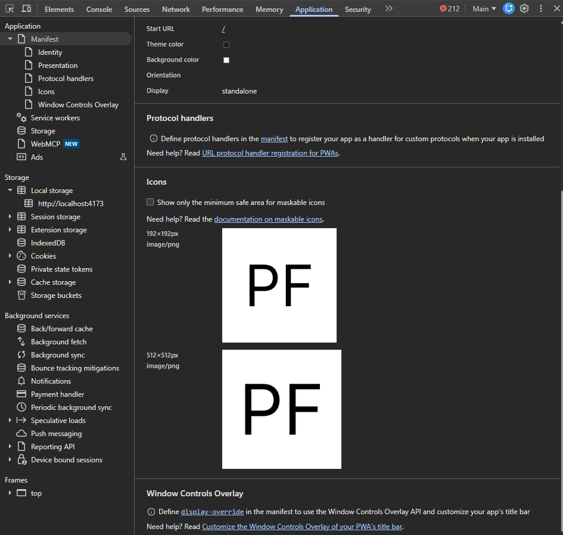
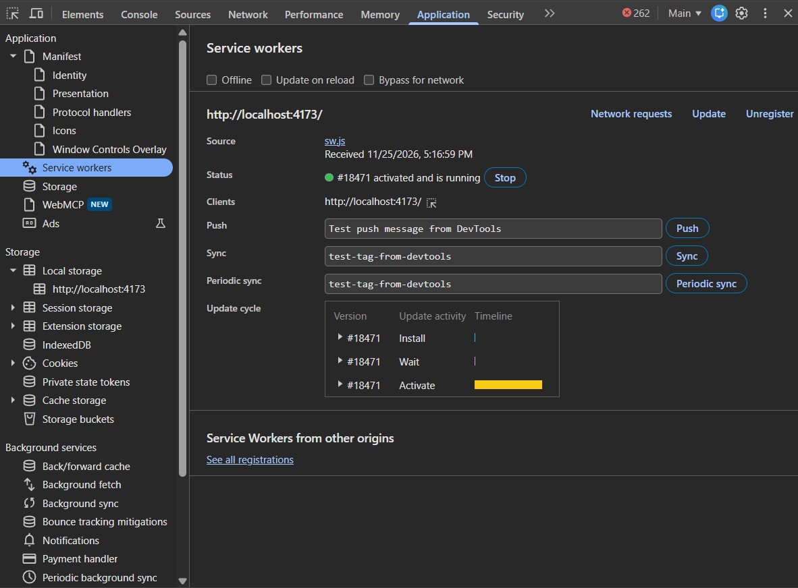
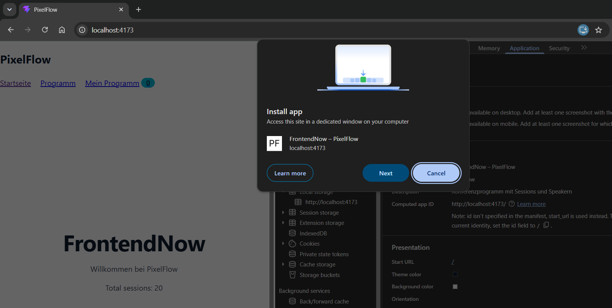

# Verifikations-Nachweis: PWA- und Offline-Funktionalität

Bezug: Szenarien siehe [Entscheidungsprotokoll](03-entscheidungsprotokoll.md), Caching-Regeln A–D siehe `vite.config.ts`  
Testumgebung: Produktions-Build (`npm run build` + `npm run preview`, http://localhost:4173), Commit `b82bcd5`

## 1. Installierbarkeit und PWA-Audit

Ab Lighthouse 12 (aktuelle Chrome DevTools) gibt es keine PWA-Kategorie mehr. Das Audit wurde deshalb mit `npx lighthouse@11 http://localhost:4173 --only-categories=pwa --view` durchgeführt.

| Prüfpunkt | Werkzeug | Ergebnis | Nachweis |
|---|---|---|---|
| Manifest gültig (Name, Icons 192/512, `display: standalone`, `theme_color`, `start_url`) | DevTools → Application → Manifest | Bestanden, alle Felder vorhanden | `assets/e-manifest-1.png`, `assets/e-manifest-2.png` |
| Service Worker registriert und aktiv | DevTools → Application → Service Workers | Bestanden, Status „activated and is running" | `assets/e-service-worker.png` |
| Installierbar (Install-Symbol in der Adressleiste / Installier-Prompt) | Chrome | Bestanden, Installier-Prompt erscheint | `assets/e-install-prompt.png` |
| Lighthouse „Installable" | Lighthouse 11 | Bestanden | `assets/e-lighthouse-pwa.png` |
| Lighthouse „PWA Optimized", erster Durchlauf | Lighthouse 11 | 2 Warnungen: kein `<meta name="theme-color">` in `index.html`, kein maskierbares Icon im Manifest | `assets/e-lighthouse-pwa.png` |
| Lighthouse „PWA Optimized" nach Korrektur | Lighthouse 11 | Bestanden, alle Prüfpunkte erfüllt | `assets/e-lighthouse-pwa-2.png` |

Zu den Warnungen: `theme_color` im Manifest gilt nur für die installierte App. Die Adressleiste im normalen Browser-Tab liest stattdessen das Meta-Tag in `index.html`. Die Icons hatten keinen `purpose` und durften deshalb von Android nicht in Kreis- oder andere Formen zugeschnitten werden. Korrektur: `<meta name="theme-color" content="#101c2c">` ergänzt und `icon-512.png` zusätzlich mit `purpose: "maskable"` eingetragen. Die Datei eignet sich dafür, weil der Hintergrund die ganze Fläche ausfüllt und „PF" innerhalb der Safe Zone liegt.

## 2. Offline-Nachweise je Szenario

Die folgenden Belege stammen aus den Testdurchläufen im [Entscheidungsprotokoll](03-entscheidungsprotokoll.md#testszenarien) und werden hier den Szenarien zugeordnet.

| Szenario | Was belegt wird | Nachweis | Ergebnis |
|---|---|---|---|
| i – Session-Übersicht offline (vor Fix) | Nach einem Besuch nur der Precache vorhanden, offline Fehlermeldung aus `main.ts` | [Cache Storage](assets/szenario-1-cache-storage.png), [Fehlermeldung Firefox](assets/szenario-1-network-offline.png), [Fehlermeldung Chrome](assets/szenario-1-offline-fehlermeldung.png) | Nicht bestanden, Lücke aufgedeckt |
| i – Session-Übersicht offline (nach Fix `b82bcd5`) | Alle drei Runtime-Caches nach einem Besuch befüllt, alle Requests vom Service Worker beantwortet | [Cache Storage](assets/szenario-1-cache-storage-1.png), [Netzwerk-Tab „service worker"](assets/szenario-1-service-worker-transferred.png) | Bestanden |
| ii – „Mein Programm" offline | localStorage-Eintrag vorhanden, Ansicht offline vollständig, Entfernen bleibt nach Reload erhalten | [Chrome offline](assets/szenario-2-chrome-offline.png), [Local Storage](assets/szenario-2-local-storage.png), [Firefox offline](assets/szenario-2-my-program-offline.png), [nach Entfernen](assets/szenario-2-my-program-offline-2-sessions.png) | Bestanden |
| iii – Erstbesuch offline | Browser-Fehlerseite, kein Service Worker vorhanden | [Chrome](assets/szenario-3-erstbesuch-offline.png), [Firefox](assets/szenario-3-erstbesuch-offline-firefox.png) | Erwarteter Grenzfall |

## 3. Einordnung

Getestet wurde der Produktions-Build lokal in zwei Browsern: Chrome (Person 1) und Firefox 161 (Person 2). Die Installierbarkeit wurde mit einem Lighthouse-11-PWA-Audit und den DevTools-Panels *Manifest* und *Service Workers* geprüft. Offline wurde in Chrome über den DevTools-Offline-Modus simuliert, in Firefox über das Throttling „Offline" oder durch Stoppen des Preview-Servers. Als Beleg dienten Cache Storage, Local Storage und die Spalte „Übertragen" im Netzwerk-Tab.

Die Ergebnisse zeigen, dass die App installierbar ist und nach einem Onlinebesuch die Session-Übersicht und „Mein Programm" offline vollständig funktionieren. Das Audit meldete zwei Optimierungshinweise (Theme-Color-Meta-Tag, maskierbares Icon), die nachträglich behoben wurden. Die Tests haben außerdem eine echte Lücke aufgedeckt: Vor Commit `b82bcd5` wurden die Runtime-Caches erst beim zweiten Laden befüllt.

Es bleiben folgende Lücken: Getestet wurde nur auf localhost und am Desktop, nicht auf einem echten Smartphone im Flugmodus oder mit gedrosseltem Konferenz-WLAN. Der Erstbesuch offline wird bewusst nicht unterstützt. Ein Update des Programms nach einer Raumänderung wurde nicht getestet, weil Cache First ohne Ablaufdatum alte Daten behält. In Firefox ist die Netzwerk-Anzeige im DevTools-Offline-Modus nicht eindeutig, deshalb wurde dort zusätzlich der Cache Storage geprüft.
